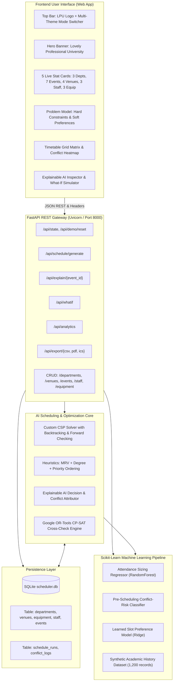

# System Architecture: LPU Multi-Department Event Scheduling & Resource Conflict Resolution Engine

## 1. High-Level Architecture

---

## 2. Mathematical CSP Formulation

The problem is structured as a formal Constraint Satisfaction Problem:

$$\mathcal{P} = \langle \mathcal{X}, \mathcal{D}, \mathcal{C}, \mathcal{O} \rangle$$

### 2.1 Variables ($\mathcal{X}$)
- For each event $E_i \in \text{Events}$ ($i = 1, \dots, N$):
  $$\mathcal{X} = \{E_1, E_2, \dots, E_N\}$$

### 2.2 Domains ($\mathcal{D}$)
- Each domain value is a tuple $\langle v, \mathbf{t} \rangle$ where $v \in \text{Venues}$ and $\mathbf{t} = [t_1, t_2, \dots, t_{d_i}]$ is a contiguous sequence of hourly time slots of length $d_i = E_i.\text{duration\_slots}$.
- Static candidate pruning enforces:
  1. $v.\text{capacity} \ge E_i.\text{expected\_attendance}$
  2. $E_i.\text{required\_venue\_type} \in \{\text{null}, v.\text{venue\_type}\}$
  3. $\mathbf{t} \subseteq E_i.\text{allowed\_slots} \cap v.\text{available\_slots}$
  4. $\forall s \in E_i.\text{required\_staff\_ids}: \mathbf{t} \subseteq \text{Staff}(s).\text{available\_slots}$
  5. If $E_i.\text{fixed\_start\_slot}$ is specified, $t_1 == E_i.\text{fixed\_start\_slot}$.

### 2.3 Hard Constraints ($\mathcal{C}$) - Must Never Be Violated
1. **Venue Exclusivity**:
   $$\forall E_j, E_k \, (j \ne k): \text{Venue}(E_j) = \text{Venue}(E_k) \implies \text{Slots}(E_j) \cap \text{Slots}(E_k) = \emptyset$$
2. **Buffer Spacing**:
   $$\text{Venue}(E_j) = \text{Venue}(E_k) \implies \text{Gap}(\text{Slots}(E_j), \text{Slots}(E_k)) \ge \max(E_j.\text{buffer}, E_k.\text{buffer})$$
3. **Faculty Availability & Non-Overlap**:
   $$\forall E_j, E_k \, (j \ne k): (\text{Staff}(E_j) \cap \text{Staff}(E_k) \ne \emptyset) \implies \text{Slots}(E_j) \cap \text{Slots}(E_k) = \emptyset$$
4. **Pooled Equipment Capacity**:
   $$\forall t \in \text{Slots}, \forall eq \in \text{Equipment}: \sum_{E_j \in \text{Active}(t)} E_j.\text{equipment}[eq] \le \text{Capacity}(eq)$$

### 2.4 Soft Cost Objective Function ($\mathcal{O}$) - Minimization
When multiple valid domain candidates satisfy all hard constraints, the solver minimizes the total penalty:
$$\text{Cost}(E_i, v, \mathbf{t}) = w_v \cdot \mathbb{I}(v \ne E_i.\text{preferred\_venue}) + w_h \cdot |\text{hour}(t_1) - E_i.\text{preferred\_hour}| + w_l \cdot \mathbb{I}(\text{end\_hour} > 17) + \text{ML\_Penalty}(E_i, v, \mathbf{t})$$
Default weights: $w_v = 3$, $w_h = 1$, $w_l = 2$.

---

## 3. Search Heuristics

1. **Priority Tiering**:
   - $\text{Rank}: \text{Critical} (0) \prec \text{High} (1) \prec \text{Normal} (2) \prec \text{Low} (3)$.
   - Critical events branch first, securing scarce resources (e.g. Mr. Bob, Portable PA System).
2. **Minimum Remaining Values (MRV)**:
   - Within the same priority tier, choose $E_i$ minimizing $|\text{DynamicDomain}(E_i)|$.
3. **Degree Heuristic**:
   - Breaks MRV ties by picking the event with the greatest number of resource constraints:
     $$\text{Degree}(E_i) = |\text{required\_staff}| + \sum \text{required\_equipment}$$
4. **Least-Cost Value Ordering**:
   - Branches on candidate tuples in ascending order of soft-cost penalty.

---

## 4. Google OR-Tools CP-SAT Cross-Check

The system models the identical scheduling problem in Google OR-Tools:
- Uses integer boolean indicators $x_{e,v,t} \in \{0, 1\}$.
- Adds `model.Add(sum(x_{e,v,t}) == scheduled_e)`.
- Adds linear inequalities for venue exclusivity and equipment pooling.
- Solves with `cp_model.CpSolver()` and cross-validates schedule concordance.
